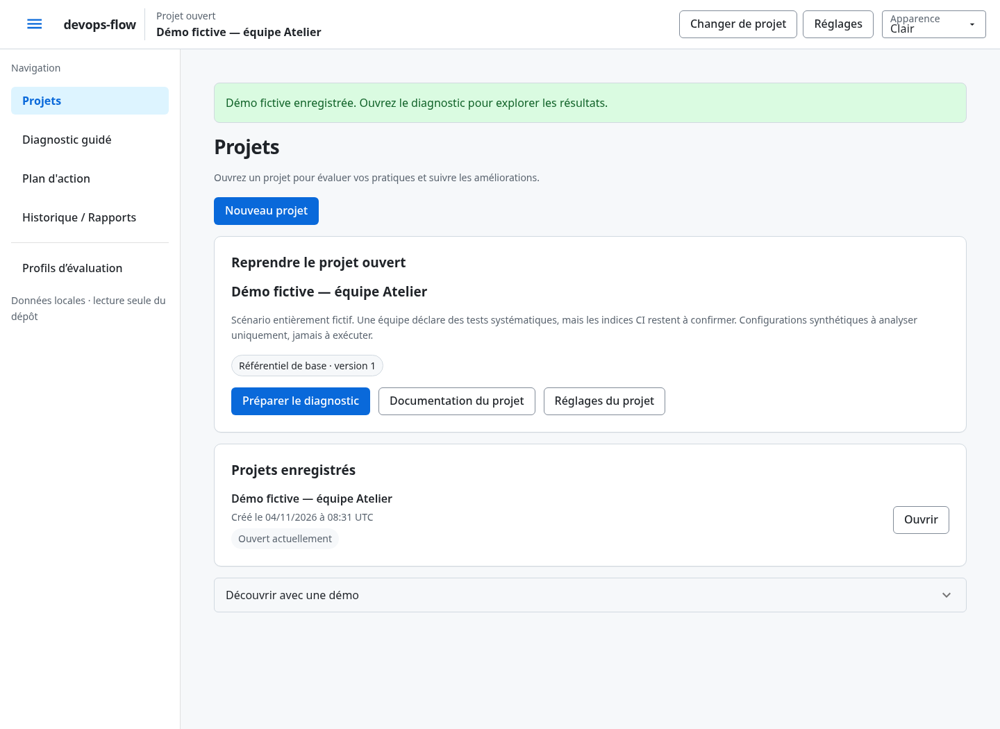
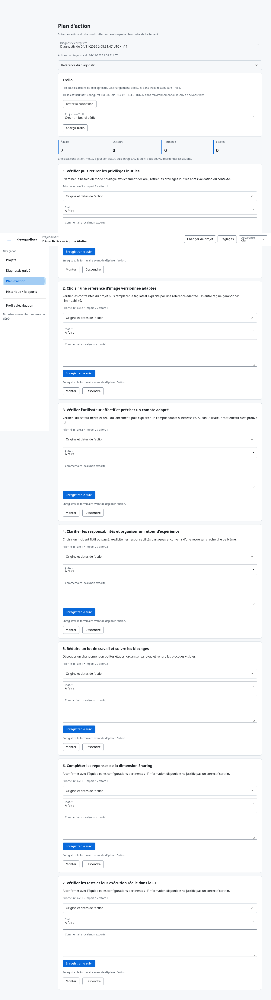
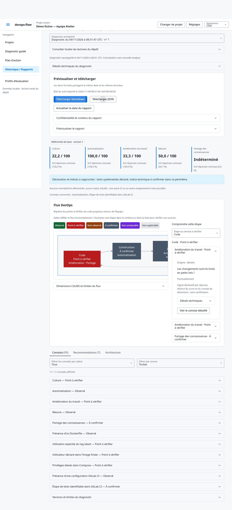
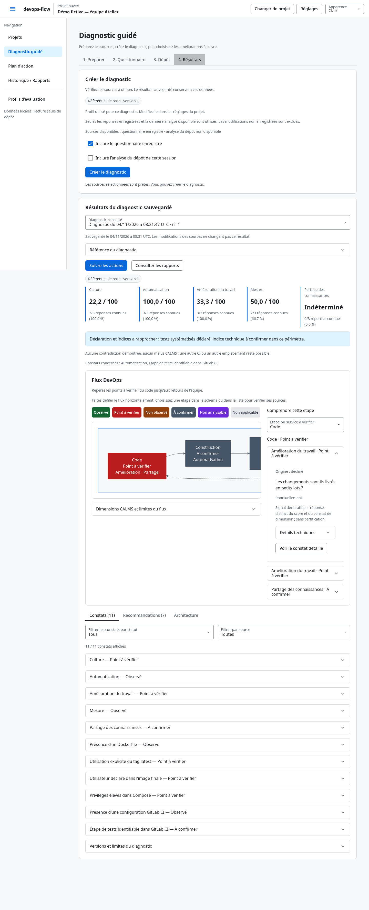
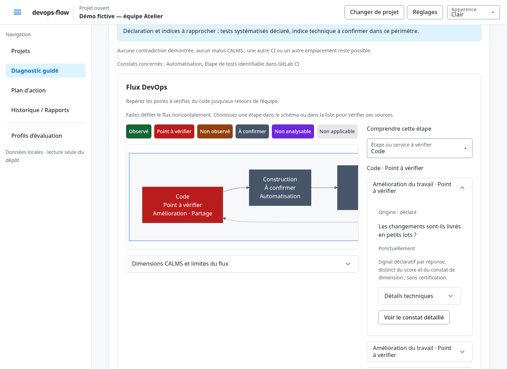
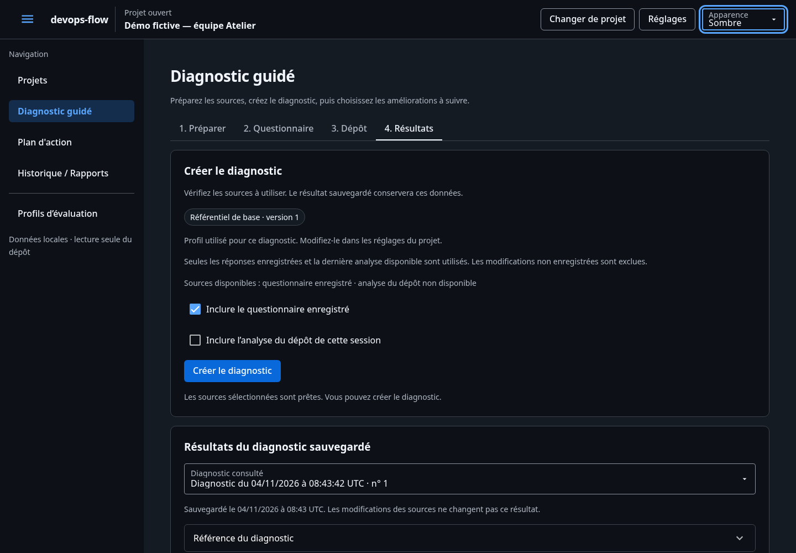

# devops-flow

Évaluez les pratiques DevOps de votre équipe, confrontez vos réponses à des indices techniques et suivez les actions prioritaires. L’application fonctionne sur votre machine, en français, avec une base SQLite locale. Aucun compte ni service distant n’est nécessaire à l’usage.

## Installer et lancer

Python ≥3.11 est requis. Sous Linux, ouvrir un terminal à la racine du projet :

```bash
python3 -m venv .venv
source .venv/bin/activate
python -m pip install -e .
python app.py
```

Ouvrir [devops-flow en local](http://127.0.0.1:8501). Arrêter avec `Ctrl+C`.
Pour les utilisations suivantes, activer le même environnement et relancer la dernière commande.
L’installation initiale nécessite un accès au dépôt de paquets. Le scan distant nécessite un accès Internet ; l’interface et les données restent locales.

Sous Windows, les commandes suivantes sont proposées mais **n’ont pas été vérifiées** :

```powershell
py -3 -m venv .venv
.\.venv\Scripts\python.exe -m pip install -e .
.\.venv\Scripts\python.exe app.py
```

Linux est le seul environnement actuellement vérifié. Le scan d’un dossier local est refusé si les primitives de protection requises sont indisponibles ; les autres systèmes restent à vérifier.

## Commencer un diagnostic

1. Dans **Projets**, créer un projet ou ouvrir un projet enregistré. Pour découvrir les fonctions, utiliser **Charger une démo** : un nouveau projet fictif est créé sans écraser les autres.
2. Choisir **Préparer le diagnostic**. Dans **1. Préparer**, choisir pratiques, dépôt ou les deux et suivre **Votre prochaine action**.
3. Dans **2. Questionnaire**, décrire les pratiques puis cliquer sur **Enregistrer le questionnaire**. Dans **3. Dépôt**, choisir un ZIP, un dossier local ou un dépôt distant, puis **Analyser le dépôt**.
4. Dans **4. Résultats**, vérifier les sources puis **Créer le diagnostic**. Un questionnaire enregistré, une analyse du dépôt ou les deux suffisent.
5. Consulter les constats, puis **Suivre les actions** ou **Consulter les rapports**.

Un questionnaire entièrement « Je ne sais pas » est admissible : ses scores sont indéterminés et sa couverture est nulle. Un scan sans fichier ciblé peut être admissible avec des indices « Non observé ». Un import rejeté ne constitue pas une source. Sans source sélectionnée et disponible, la finalisation est refusée.



## Suivre les actions

Dans **Plan d’action**, sélectionner le diagnostic. La synthèse compte les actions **À faire**, **En cours**, **Terminée** et **Écartée**. Modifier un statut ou un commentaire, puis **Enregistrer le suivi** ; une confirmation apparaît après l’enregistrement.

Utiliser **Monter** et **Descendre** pour réorganiser les actions. Enregistrer le formulaire avant un déplacement. L’ordre manuel ne change pas la priorité initiale, calculée par impact / effort décroissant, puis identifiant croissant en cas d’égalité. Les commentaires restent locaux, avec une limite de 2 000 caractères.

Chaque diagnostic possède son propre suivi. Modifier le brouillon, rescanner ou suivre une action ne recalcule pas les diagnostics déjà enregistrés.



## Consulter l’historique et exporter

Dans **Historique / Rapports**, sélectionner un diagnostic, puis **Télécharger Markdown** ou **Télécharger JSON**. Les deux formats et leurs aperçus utilisent le même objet daté en UTC. Une modification du suivi actualise cet objet ; **Actualiser la date du rapport** renouvelle explicitement sa date.

Les rapports comprennent les identifiants, dates, versions, réponses, scores et couvertures, constats, preuves contrôlées, recommandations et état des actions. Ils excluent les noms et descriptions des projets, notes CALMS, commentaires, chemins absolus, noms d’archives et contenus bruts. Les rapports report-v4 incluent l’architecture et les chemins relatifs validés ; les anciens formats conservent leur politique. Les fichiers portent uniquement les identifiants du projet et du diagnostic.



## Comprendre les résultats

- **Score CALMS** : indicateur déclaratif par dimension. Les réponses connues vont de 0 à 3 ; le score est leur somme divisée par trois fois leur nombre, ramenée sur 100. Les inconnus sont exclus. Aucun score global n’est calculé.
- **Couverture** : proportion de réponses connues, distincte du score.
- **Constat** : déclaration ou indice statique, accompagné de son origine et de ses limites. « Non observé » ne prouve pas l’absence d’une pratique ; « À confirmer » exprime une information insuffisante.
- **Recommandation** : action reliée aux constats, avec impact, effort, priorité et justification. Les conventions de classement sont internes ; elles ne constituent pas une certification.

Les onglets **Constats** et **Recommandations** séparent les observations des actions proposées. Les versions et limites restent accessibles dans une section repliable.



## Périmètre du scan

Le scan ZIP/local indexe les manifests et les configurations Docker, Compose et GitLab CI dans les sous-dossiers, avec leurs chemins relatifs complets. Un manifest définit un composant (20 maximum, composants imbriqués compris). Les stacks Python, Node/TypeScript, Go, Java et Rust sont détectées par déclarations statiques. L’onglet **Architecture** montre les signaux, leur confiance, les fichiers et les références communes. Une stack manuelle se déclare dans **Déclarer ou corriger une stack**, puis exige une nouvelle analyse. Un ZIP peut contenir un dossier enveloppe unique ; il n’est jamais extrait. Le parcours local exclut les secrets, dépendances et sorties de build. Les seules lectures de code concernent au plus trois points d’entrée candidats par composant, 200 lignes et 64 Kio chacun, dans le budget global de 6 Mio.

Six contrôles recherchent le Dockerfile, le tag `latest` explicite, l’instruction `USER` du dernier stage, les privilèges Compose, le fichier GitLab CI et un job local de test identifiable. GitLab CI reste le fournisseur provisoire ; aucune conclusion n’est établie sur les autres fournisseurs.

Les fichiers de secrets, clés et `.git/` ne sont pas ouverts. Aucun code, build, script ou include distant n’est exécuté. Le dépôt analysé n’est jamais modifié. Les preuves ne contiennent pas le contenu brut des configurations.

Limites ZIP : 10 Mio reçus, 1 000 entrées, noms de 1 024 octets UTF-8 et 32 composants maximum, 20 Mio décompressés annoncés au total, 1 Mio par fichier et ratio de compression de 100 maximum. Les lectures réelles sont bornées à 1 Mio par configuration et 6 Mio au total. Chemins suspects, liens, doublons et entrées chiffrées ou spéciales provoquent un refus. YAML : profondeur 32, 10 000 nœuds, clés textuelles uniques, aucun alias. Le parsing reste partiel et ne valide pas le fonctionnement réel d’une configuration.

Le scan est temporaire et isolé par projet et par client navigateur. L’état de travail reste en mémoire. Seul le choix d’apparence est conservé dans le navigateur. Un rechargement complet ou un redémarrage repart d’une session vide : rouvrir le projet, puis relancer le scan si nécessaire. La navigation conserve sa source et son résultat. Le fichier ZIP reçu reste en mémoire jusqu’à l’analyse, au changement de source ou à la sortie de Diagnostic guidé, puis ses octets sont libérés. **Retirer le ZIP** permet aussi d’effacer une archive en attente avant analyse. Après un retour sur la page, sélectionner de nouveau le ZIP pour relancer l’analyse ; le résultat contrôlé précédent reste finalisable. Changer de source, de chemin ou d’archive invalide ce résultat. Refaire l’analyse si les fichiers ont changé.

## Données locales et vérification

L’interface utilise NiceGUI 3.18.0 et SQLite. La base est créée dans `var/devops_flow.sqlite3`. Après un redémarrage, rouvrir le projet dans la liste. Le projet actif et le scan temporaire dépendent de la session ; les projets, questionnaires enregistrés, diagnostics et suivis sont persistants. Deux projets peuvent avoir le même nom et des identifiants distincts.

Pour une base distincte, définir `DEVOPS_FLOW_DB_PATH` avant le lancement. Lancer depuis la racine utilise la configuration locale du point d’entrée : `127.0.0.1:8501`, interface française, sans exposition distante de l’interface ni rechargement automatique.

Les installations antérieures restent compatibles : `DEVOPS_ASSIST_DB_PATH` est
utilisée si la nouvelle variable est vide ou absente. Sans configuration, la base
`var/devops_flow.sqlite3` est prioritaire si elle existe ; sinon l’ancienne base
`var/devops_assist.sqlite3` est réutilisée. Une installation neuve crée le nouveau
fichier. Aucun fichier de données n’est déplacé ni supprimé automatiquement.

Pour exécuter les tests avec des bases fictives isolées :

```bash
python -m pip install -e '.[dev]'
python -m pytest -q
python -m pip check
```

Les résultats, environnements et limites de recette sont consignés dans [TEST_RESULTS](context/TEST_RESULTS.md). Les critères V2 sont dans [ACCEPTANCE](context/ACCEPTANCE.md), l’état courant dans [STATE](context/STATE.md) et le périmètre dans [PRODUCT](context/PRODUCT.md).

## Mise à jour depuis la version précédente

Arrêter l’application existante, puis installer les dépendances et relancer :

```bash
.venv/bin/python -m pip install -e '.[dev]'
.venv/bin/python app.py
```

Pour passer de DevOps Assist à `devops-flow`, arrêter l’application puis exécuter
`.venv/bin/python -m pip uninstall -y devops-assist` avant la réinstallation
ci-dessus. Le lancement par module devient `python -m devops_flow` ; l’ancienne
commande `python -m devops_assist` est remplacée. Le dossier du projet peut garder
son nom actuel. Les préférences d’apparence du navigateur sont reprises.

Les formats de profils et marqueurs techniques Trello historiques sont conservés
pour assurer la compatibilité. Les boards existants et les documents utilisateur
ne sont pas renommés automatiquement.

La base existante est réutilisée. Aucun diagnostic n’est recalculé ni converti.
La réception ZIP vérifie aussi les limites côté serveur : un fichier de 10 Mio
maximum, réception multipart bornée en mémoire, sans extraction ni fichier temporaire.

## Profils d’évaluation

Ouvrir **Profils d’évaluation**, sous **Projets**, pour créer un référentiel ou importer
un fichier Markdown. Chaque profil définit 1 à 10 questions par dimension CALMS,
les seuils d’interprétation, les règles techniques activées et leurs poids éventuels.
Le référentiel de base `baseline` reprend les quinze questions et six règles initiales.

À la création d’un projet, choisir son profil. Pour modifier ensuite le projet ou sa
version utilisée, ouvrir **Réglages** près du nom du projet dans le bandeau supérieur. Le diagnostic
utilise ce choix sans dérogation. Chaque version possède son propre brouillon CALMS :
aucune réponse n’est transférée automatiquement à un autre questionnaire.

Un profil publié est immuable. **Publier une nouvelle version** propose une confirmation
avec les sections modifiées ; les projets restent sur leur version précédente jusqu’à
une réassignation explicite. Les diagnostics et rapports historiques conservent leur
référentiel et leurs conventions. Un profil utilisé par un projet ou diagnostic ne peut
pas être supprimé ; un profil inutilisé peut être archivé. Baseline est protégé.

Le bouton **Exporter en Markdown** permet de partager le référentiel comme fichier
local, sans envoi automatique. L’import exige un `.md` UTF-8 de 256 Kio maximum, avec
frontmatter YAML sûr, sans inclusion, alias ni entité HTML/XML. Un identifiant de profil existant permet
une nouvelle version ou un autre identifiant. Voir [l’exemple complet](docs/examples/profile-example.md).

Les conventions Markdown figurent dans les rapports et sont affichées sans images ni
HTML actif. Elles décrivent les pratiques attendues ; elles ne créent pas de nouveaux
contrôles techniques. Auteur, description, aides, notes et commentaires restent exclus
des rapports. L’application reste locale, sans compte applicatif ; la lecture distante GitLab/GitHub reste à votre demande.

Lancement également disponible : `python -m devops_flow`.

## Vérifier le flux DevOps du projet

Le **Flux DevOps**, dans Diagnostic guidé et Historique / Rapports, annote huit étapes
du résultat figé : Code, Construction, Tests, Paquet, Déploiement, Exploitation,
Observation et Retours. Les flèches représentent le flux attendu ; elles ne prouvent
pas qu’un pipeline fonctionne. Les badges CALMS indiquent les dimensions concernées,
avec Culture comme cadre transversal.

Cliquer sur une étape ou utiliser **Étape ou service à vérifier** pour lire son statut,
ses sources, ses preuves et leurs limites. **Voir le constat détaillé** ouvre la fiche
du même diagnostic dans Diagnostic guidé, même depuis l’historique. La légende met
en évidence les étapes du statut choisi ; recliquer annule la sélection. Le flux se
fait défiler horizontalement, sans réduire les textes sur petit écran.

Les types Compose reconnus sont affichés sans nom de service ni référence d’image.
Un type non reconnu reste « Service externe (type non résolu) » ; aucun service actif
n’est certifié. Les profils personnalisés restent à confirmer pour les questions sans
mapping ; les règles désactivées sont justifiées par le **profil figé**. Les réponses
baseline connues sont évaluées individuellement au seuil figé, sans modifier les scores
ou constats CALMS par dimension.

Les rapports `report-v3` historiques et `report-v4` multi-composants contiennent le même Mermaid que leur vue, dans un bloc de code
Markdown et dans `diagram.mermaid` en JSON, avec sa provenance structurée. Les anciens
diagnostics ne sont ni rescannés ni réécrits ; les signaux build/deploy et services
non enregistrés à l’époque ne sont pas inventés. Aucun export PNG/SVG natif n’est ajouté.




## Analyser un dépôt distant

Dans Diagnostic guidé → Scan technique ciblé, choisir **Dépôt distant**, le fournisseur,
l’URL HTTPS, puis une branche/tag/SHA facultatif. Laisser la référence vide pour la branche
par défaut. Pour un dépôt privé, saisir un jeton **GitLab read_api** ou **GitHub Contents
Read-only**, avec Actions Read-only pour l’historique CI. Le jeton reste en mémoire ;
**Effacer le jeton** le retire et un rechargement complet demande une nouvelle saisie.

L’acquisition fige le SHA, vérifie les types Git et lit seulement les configurations
actuelles et six manifests de racine. Ce mode conserve la façade scanner-v3 et les six règles à la racine ; il ne produit pas encore d’architecture multi-composants. Utiliser ZIP/local pour cette vue. GitHub Actions est uniquement une source de métadonnées historiques.
Une archive bornée peut servir de fallback. Aucun clone, commit ou pipeline déclenché.
Les hôtes autohébergés HTTPS publics sont acceptés ; les réseaux privés et certificats
invalides sont refusés. Les acquisitions restent manuelles, sans ordonnanceur.

Historique / Rapports présente au maximum dix commits et cinq exécutions disponibles
pour le SHA analysé. Les durées absentes restent inconnues. Les métadonnées distantes
sont stockées séparément des résultats figés et exclues des rapports Markdown/JSON.

## Documentation web et PDF

Depuis le projet ouvert, choisir **Documentation du projet** : liste des pages,
éditeur Markdown, aperçu Mermaid strict, versions et restauration dans une nouvelle
révision. La route `/projects/{id}/docs` fonctionne aussi directement. Une sauvegarde
concurrente obsolète est refusée et la saisie est conservée. Les pages restent locales.

Installer les moteurs PDF et Chromium :

```bash
python -m pip install -e '.[pdf]'
python -m playwright install chromium
```

Les bibliothèques système peuvent être installées avec
`python -m playwright install-deps chromium` (droits administrateur possibles).
Sélectionner les pages, afficher leur ordre puis **Télécharger le PDF**. Playwright
rend les diagrammes ; le fallback WeasyPrint remplace Mermaid par son code avec une
mention explicite. Les ressources externes sont interdites dans les deux moteurs.

Le PDF porte uniquement sur la documentation choisie. Les exports du diagnostic
restent Markdown/JSON. Les pages documentaires sont du texte libre : vérifier leur
contenu avant partage. Limites : 100 pages/projet, 256 Kio/page, 2 Mio/export.

Guide pas à pas : [version web/Markdown](docs/guide-utilisation.md) ·
[guide PDF](docs/guide-utilisation.pdf).

Avant mise à jour, arrêter l’application et sauvegarder la base SQLite. La migration
ajoute des tables sans réécrire les diagnostics historiques. Pour une nouvelle recette
avec les PDF : `python -m pip install -e '.[dev,pdf]'`, installer Chromium puis lancer
`python -m pytest -q`.


## Interface et compréhension des contrôles

Le projet ouvert et ses **Réglages** restent visibles en haut de l’écran. **Apparence** propose Système, Clair et Sombre, avec un accent bleu et des surfaces inspirées de GitHub. Les étapes du diagnostic restent librement accessibles et conservent la saisie pendant la session.

**Comprendre les contrôles** explique les six contrôles disponibles : trois Dockerfile, un Compose et deux GitLab CI. Ce périmètre est un choix du produit, pas une norme. Le profil détermine les contrôles activés ; les filtres ne changent que l’affichage. Les références DOC/CMP/CI restent consultables dans les détails. Les seuils et priorités sont des conventions internes dont la justification méthodologique reste ouverte.



Le [guide d’utilisation](docs/guide-utilisation.md) détaille les parcours, les réglages et les limites.

## Projeter le plan d’action dans Trello

Trello est facultatif. L’application et le suivi local fonctionnent sans compte Trello.
Pour activer les opérations Trello, fournir une clé API et un token avec les droits
**read,write** dans l’environnement du processus, ou dans le seul fichier `.env`
à la racine de devops-flow :

```dotenv
TRELLO_API_KEY=votre_cle_api
TRELLO_TOKEN=votre_token
```

Les variables d’environnement priment, y compris lorsqu’elles sont vides. Le `.env`
est déjà exclu de Git ; ne jamais y mettre les identifiants d’un dépôt audité.
Le chargement n’effectue aucune recherche dans le dossier analysé. Les identifiants
ne sont enregistrés ni en base ni dans le navigateur. Ils ne s’appliquent qu’à Trello,
pas aux connecteurs GitLab/GitHub. Redémarrer l’application après modification de
son environnement. [Créer une clé et autoriser un token Trello](https://developer.atlassian.com/cloud/trello/guides/rest-api/authorization/).

Dans **Plan d’action**, sélectionner un diagnostic, puis :

1. **Aperçu Trello** affiche le board, les listes, les cartes et les checklists,
   sans appel réseau ni création. Cet aperçu reste disponible sans identifiants.
2. **Tester la connexion** vérifie les identifiants et affiche le nom d’utilisateur.
3. **Créer le board Trello** envoie les actions affichées vers un nouveau board privé
   nommé `<nom du projet> — devops-flow`, sans workspace explicitement choisi.

Les listes sont **À faire**, **En cours**, **Terminé**, **Écarté**. Les cartes suivent
l’ordre local et le statut enregistré ; enregistrer son suivi avant l’aperçu. Chaque
carte reçoit **Critères de vérification**, avec les critères du catalogue lorsqu’ils
sont disponibles pour sa version, sinon **Preuve d’intégration fournie** et **Revue
effectuée**. Tous les critères sont initialement non cochés, même pour une action
terminée : son statut ne prouve pas qu’une vérification a été réalisée.

L’envoi contient le nom du projet dans le nom du board, les recommandations,
priorités, références d’actions/diagnostic et critères. Notes CALMS, commentaires,
description du projet et contenus du dépôt ne sont pas envoyés.

Un board déjà associé propose **Ajouter les nouvelles actions uniquement** ou
**Recréer un nouveau board**. Une action est reconnue par son identifiant local,
pas par son titre : un nouveau diagnostic peut donc ajouter des cartes de même titre.
L’ajout ne modifie pas les cartes existantes, même déplacées, éditées ou supprimées
manuellement. La recréation conserve les anciens boards et projette seulement le
diagnostic sélectionné. Il n’existe aucune synchronisation inverse.

Après interruption, **Reprendre la projection** utilise l’aperçu enregistré et
complète les éléments manquants. Ne pas modifier les marqueurs devops-flow dans
les descriptions pendant une projection incomplète : ils permettent de retrouver les
créations dont la réponse s’est perdue. Si une création reste introuvable ou ambiguë,
l’application suspend l’opération pour éviter un doublon ; vérifier Trello puis
reprendre, ou choisir explicitement un nouveau board. Aucun rollback distant ni
suppression automatique n’est effectué. Un board ou une liste archivé doit être
rouvert dans Trello, ou remplacé par un nouveau board.

Les erreurs d’identifiants et de permissions demandent une correction ; les erreurs
temporaires de lecture sont réessayées avec backoff. Un 429 respecte `Retry-After`
(10 secondes s’il manque) ; les attentes supérieures à 60 secondes affichent une date
de reprise. Le service ne répète jamais aveuglément une création incertaine.


La procédure et la matrice de détection multi-composants sont détaillées dans [Architecture DevOps](docs/ARCHITECTURE_DEVOPS.md).
