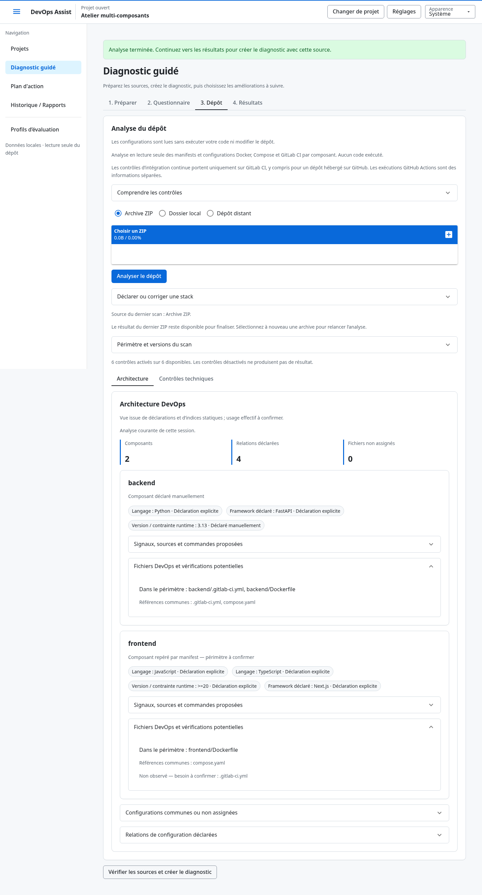

# Architecture DevOps multi-composants

La vue décrit des déclarations et des indices statiques, sans comprendre le code
ni prouver l’usage des technologies. Aucun fichier audité n’est exécuté ou modifié.

## Utiliser la vue

1. Dans Diagnostic guidé → Dépôt, analyser un ZIP ou un dossier local.
2. Ouvrir **Architecture** : chaque répertoire contenant un manifest devient un
   composant. Plusieurs manifests au même chemin forment un seul composant,
   éventuellement avec plusieurs langages ; les composants imbriqués sont séparés.
3. Consulter les cartes et ouvrir les signaux : provenance, confiance, point
   d’entrée candidat, port, noms de variables, commandes et services éventuels.
4. Examiner les fichiers DevOps, les vérifications potentielles et les relations.
   Une CI racine ne prouve pas les tests de tous les composants. Les autres
   fournisseurs CI ne sont pas évalués par les six contrôles actuels.
5. Créer le diagnostic. Dans Résultats, Architecture appartient au diagnostic
   sélectionné ; les constats se filtrent par composant et les actions se suivent
   indépendamment. Le flux ajoute un nœud par composant en multi-composants.

Les chemins sont relatifs à la racine de scan. Un ZIP enveloppé d’un seul dossier
conserve la convention historique : cette enveloppe est retirée. Sans manifest,
aucun composant automatique n’est inventé ; les configurations restent analysées
au niveau projet. Les fichiers sans propriétaire ni référence explicite apparaissent
comme non assignés.

## Détections disponibles

| Stack | Manifests | Informations reconnues |
|---|---|---|
| Python | pyproject.toml, setup.py, setup.cfg, requirements.txt, Pipfile | Contraintes runtime et .python-version ; Django/FastAPI/Flask/Starlette/aiohttp ; pytest et commande de build conventionnelles ; indices de clients de services |
| Node/TypeScript | package.json | engines.node, .nvmrc/.node-version, TypeScript déclaré ; Express/NestJS/Next.js/React/Vue/Nuxt/Angular/Svelte/SvelteKit ; commandes npm build/test et indices de clients de services |
| Go | go.mod | Directives go/toolchain, Gin/Echo/Fiber ; commandes go build/test conventionnelles et indices de clients de services |
| Java | pom.xml, build.gradle, build.gradle.kts | Propriétés runtime Maven ou littéraux Gradle, Spring Boot/Quarkus/Micronaut ; commandes Maven/Gradle conventionnelles et indices de clients de services |
| Rust | Cargo.toml | rust-version, toolchain numérique ; Axum/Actix Web/Rocket ; commandes cargo build/test conventionnelles et indices de clients de services |

Gemfile, composer.json, mix.exs et les fichiers .csproj identifient une frontière
de composant, mais leur contenu n’est pas lu par un scanner de stack. Déclarer
manuellement les informations utiles. Les constructions dynamiques restent à
confirmer ; aucune dépendance, interpolation, inclusion ou template n’est résolu.

Les points d’entrée sont des candidats conventionnels du langage ou des chemins
statiques déclarés dans les manifests. Des indices lexicaux limités peuvent y
repérer un port ou un nom de variable. Une valeur d’environnement n’est jamais
conservée. La présence d’un script build/test fournit une commande canonique,
jamais une copie du script ni une preuve qu’il fonctionne.

| Confiance | Interprétation |
|---|---|
| high | Déclaration explicite ; usage effectif non établi |
| medium | Convention ou relation à confirmer |
| low | Hypothèse faible issue d’un indice lexical ou d’une dépendance cliente |
| manual | Déclaration utilisateur |
| unknown | Information insuffisante ou construction non résolue |

Les ports conventionnels de certains frameworks sont proposés seulement sans
port littéral repéré pour cette stack. Plusieurs versions/ports déclarés restent
visibles, avec une invitation à vérifier leur portée. Un Dockerfile ou une CI
non observé constitue une vérification potentielle, pas une obligation établie.
Compose n’est pas exigé systématiquement.

## Configurations communes

Le propriétaire d’un fichier est son composant ancêtre le plus proche. Compose
peut rattacher un composant par un contexte local de build, ou plus faiblement
par le chemin d’un Dockerfile indexé. Les services ainsi rattachés sont contrôlés
séparément ; les dépendances Compose entre composants sont des relations déclarées.
Un service externe reconnu par son image peut fournir un type contrôlé.

GitLab peut fournir une référence locale vers une configuration de composant.
Les fichiers sont indexés indépendamment : les includes ne sont ni suivis ni
exécutés. Le résultat d’un job racine n’est pas attribué automatiquement à tous
les composants. Les fichiers globaux gardent leur analyse au niveau projet.

## Déclarer ou corriger une stack

Dans **Déclarer ou corriger une stack**, saisir le chemin relatif (`.` pour la
racine), puis au moins un champ. Les déclarations sont persistantes par projet
et s’appliquent aux prochains scans ZIP/local. Elles priment pour le champ déclaré
sans supprimer les signaux automatiques.

Enregistrer ou supprimer invalide l’analyse courante : relancer le scan, en
sélectionnant à nouveau le ZIP si nécessaire. Un chemin non retrouvé dans le scan
produit une déclaration inactive. Après un conflit entre sessions, **Recharger
les déclarations** abandonne la saisie courante et recharge les valeurs enregistrées.
Les erreurs de validation conservent la saisie pour correction.

Une modification ne change aucun diagnostic sauvegardé. Les diagnostics antérieurs
sans architecture restent consultables ; aucune vue rétrospective n’est inventée.

## Bornes et confidentialité

- 20 composants maximum, déclarations actives comprises ; dépassement refusé.
- ZIP : 10 Mio, 1 000 entrées, 20 Mio annoncés, 1 Mio/fichier, ratio 100 ;
  aucune extraction et validation complète des métadonnées avant lecture.
- Local : 1 000 entrées visitées ; chemins de profondeur 32 et 1 024 octets.
  Répertoires secrets, dépendances, caches et sorties usuelles exclus.
- 6 Mio lus au total. Au plus trois candidats d’entrée par composant,
  200 lignes et 64 Kio chacun, dans ce budget.
- Aucun lien symbolique suivi, fichier spécial, accès hors racine, installation,
  import ou exécution de code audité. Les systèmes sans primitives nécessaires
  refusent le scan local ; Linux est l’environnement vérifié.
- Les rapports report-v4 incluent les chemins relatifs validés et les signaux
  contrôlés. Ils excluent chemins absolus, secrets, valeurs d’environnement,
  scripts et contenus bruts. Les anciens rapports conservent leur politique.
- Trello conserve ses titres génériques et identifiants opaques : aucune nouvelle
  transmission de chemins ou contenus du dépôt.

Le mode GitLab/GitHub distant conserve son acquisition à la racine et ses indices
historiques ; utiliser ZIP/local pour l’architecture multi-composants. Aucun
générateur Dockerfile, Compose ou CI n’est livré par ce chantier.

## Recette manuelle reproductible

Avec une base fictive, utiliser un dépôt contenant backend/pyproject.toml,
frontend/package.json, leurs Dockerfiles et un Compose racine avec deux contextes
de build. Vérifier deux cartes, leurs confidences, fichiers et relations ; une
CI locale backend ne doit pas satisfaire automatiquement le frontend.

Créer le diagnostic, filtrer un composant, ouvrir un constat depuis Architecture
et le flux, puis suivre deux actions semblables indépendamment. Télécharger les
rapports et vérifier la même date, les chemins relatifs et l’absence de valeurs
sentinelles placées dans .env, des scripts et des configurations.

Déclarer une autre version runtime, constater l’invalidation du scan, rescanner
et comparer l’ancien diagnostic à l’identique. Recharger le navigateur pour
retrouver la déclaration. Essayer une sauvegarde concurrente et sa reprise.

Rejouer en clair/sombre, à 390 px et au clavier ; vérifier les textes >=14 px,
le contraste, les détails repliables et l’absence de débordement global. Ouvrir
un ancien diagnostic sans architecture, puis vérifier un refus de ZIP, un
21e composant et un scan vide sans affirmation d’absence de pratique.

## Vérifications réalisées

La recette Chromium sur base fictive a exercé les uploads et téléchargements
réels, deux composants et quatre relations, le flux rendu, les liens vers les
constats, la déclaration persistante, le rescan et l’historique sans recalcul.
Aucune requête externe ni erreur JavaScript. À 390 px : largeur globale 390 px,
texte minimum 14 px. Sur 273 échantillons : aucun contraste inférieur à 4,5:1,
minimum 4,56:1 clair et 5,19:1 sombre ; douze déplacements clavier vérifiés.
Relevés : [architecture-recette.json](architecture-recette.json).

Les suites et échecs intermédiaires sont consignés dans context/PLAN.md.
Autres systèmes, navigateurs et lecteur d’écran non vérifiés ; aucune
certification exhaustive d’accessibilité.
