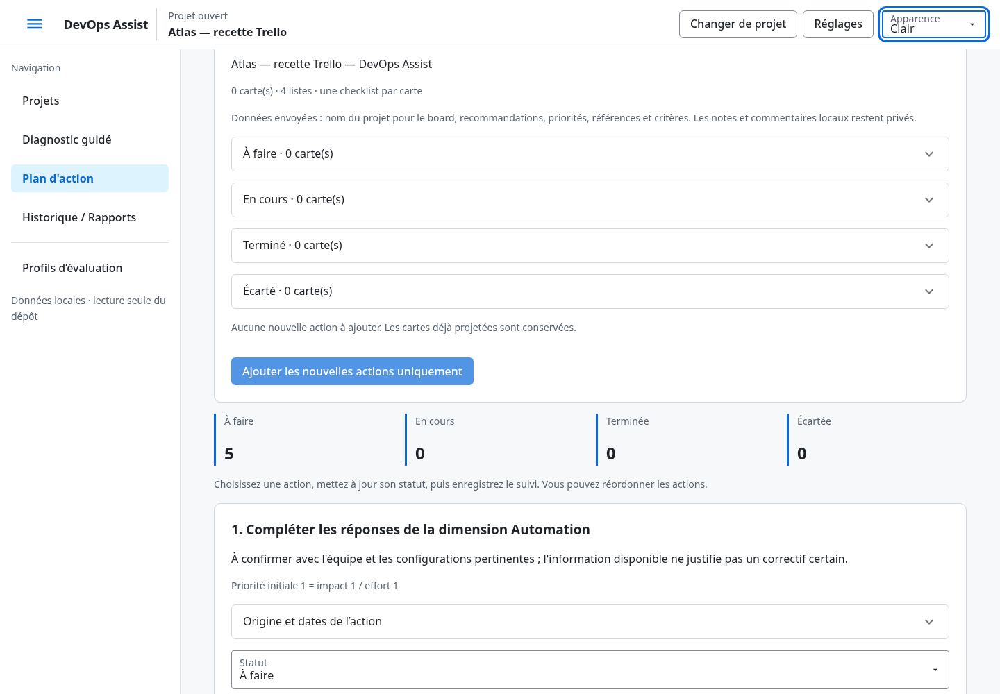
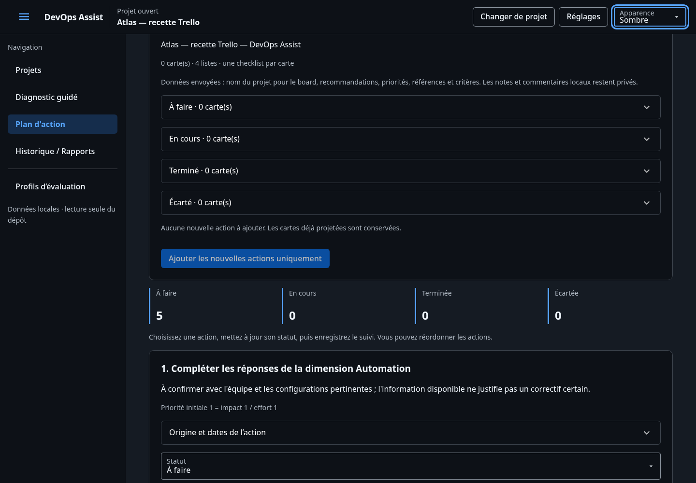
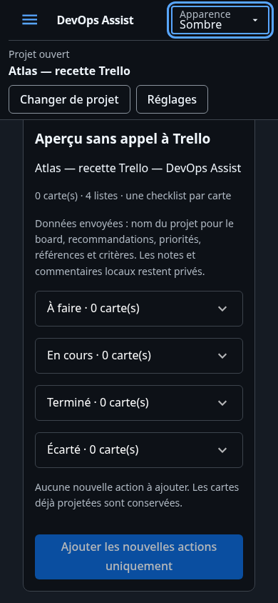

# Vérifier la projection Trello

Le paramétrage et les limites sont décrits dans la section Trello du [README](../README.md).
Le suivi local reste disponible sans identifiants. Aucune synchronisation inverse.

## Rendu attendu

Dans Plan d'action, le contexte du diagnostic précède une carte Trello. Configuration,
connexion et choix de projection sont distincts. L'aperçu compte les cartes par liste ;
chaque carte se développe pour afficher la description et les critères. La création
est l'action primaire, désactivée sans identifiants ou sans nouvelles actions. Pendant
le traitement, elle reste désactivée et une progression réelle apparaît. Le succès
propose le lien du board et revient au mode ajout. Les erreurs indiquent la correction
ou la reprise possible sans afficher de réponse HTTP brute.

Les deux apparences utilisent les tokens existants. À 390 px, la section et les boutons
restent dans la largeur disponible ; les descriptions se replient et les contrôles
restent accessibles au clavier. Les liens ne chargent Trello que sur action volontaire.

## Procédure de vérification manuelle

1. Lancer l'application localement, créer ou ouvrir une démo puis son Plan d'action.
   Sans identifiants Trello, vérifier que le suivi fonctionne, que « Tester la
   connexion » est désactivé et que « Aperçu Trello » présente cartes et checklists.
2. Vérifier les quatre listes, les titres issus du diagnostic et les critères.
   Enregistrer un changement de suivi après un aperçu : la création doit demander
   son actualisation. Les saisies non enregistrées ne sont pas projetées.
3. Avec un compte de test configuré volontairement, tester la connexion puis créer
   le board. Vérifier ses quatre listes, une carte par action, la checklist et ses
   éléments initialement non cochés. Les notes et commentaires restent absents.
4. Refaire l'aperçu en mode ajout : aucune carte nouvelle. Modifier une carte dans
   Trello et vérifier que l'ajout ne l'écrase pas. Sélectionner un autre diagnostic
   pour ajouter ses propres actions, puis choisir explicitement la recréation et
   vérifier que l'ancien board reste disponible.
5. Recharger la page : lien et correspondances restent accessibles. Tester le parcours
   au clavier, les apparences claire/sombre et une fenêtre de 390 px. Les erreurs
   de permissions doivent rester lisibles ; un board archivé doit être rouvert ou
   remplacé volontairement.

Les interruptions après création mais avant réponse, les checklists partielles,
les doublons de clic et les codes 401/403/429/5xx sont reproduits sans compte réel
par les tests test_trello.py, test_trello_projection.py et test_ui_trello.py.

## Recette exécutée

Serveur isolé 127.0.0.1:8530 et base fictive dans /tmp/devops-assist-trello-browser.
API httpx.MockTransport uniquement ; aucun envoi réel vers Trello. Deux générations
ont créé deux boards, huit listes, dix cartes, dix checklists et vingt éléments.
Aperçu sans API, ajout vide, recréation, snapshots identiques, mobile/clavier et
absence de requêtes externes/erreurs JavaScript vérifiés dans Chromium. Les captures
fictives et le relevé sont conservés avec cette documentation ; les commandes et
échecs intermédiaires sont dans context/PLAN.md et context/TEST_RESULTS.md.

Mesures ciblées : 173 échantillons, aucun échec ; minima 4,56:1 en clair et 5,50:1 en
sombre, textes mesurés ≥14px. Après rechargement : board retrouvé et aperçu sans
nouvel appel API. Ces mesures ne constituent pas une certification d'accessibilité.
Relevé : [trello-recette.json](trello-recette.json).
